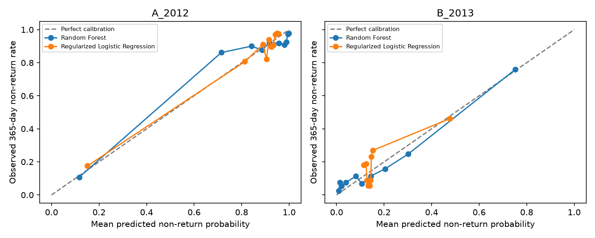

# Phase 10: Machine Learning Feasibility for 365-Day Observed Non-Return

## Decision

**C) More historical data or better business definitions are required before credible prediction.** The diagnostic models can rank or classify these historical labels to varying degrees, but the data contain only two sharply different regimes, no representative future evaluation window, substantial cross-snapshot identity overlap, and a noisy 365-day non-return target. This phase does not support deployment or a claim of permanent churn prediction.

## Objective and target

Assess whether cutoff-safe customer features contain useful signal for `AnalyticalChurn=1` (no observed order in the fully observed 365 days after cutoff). `AnalyticalChurn=0` means at least one observed return. “Non-return” is limited to that window; later return remains possible.

## Populations and validation

| Snapshot | Cutoff | Customers | Non-return (positive class) | Return | Non-return prevalence |
|---|---|---:|---:|---:|---:|
| A_2012 | 2012-06-30 | 2,799 | 2,342 | 457 | 83.7% |
| B_2013 | 2013-06-30 | 6,206 | 1,050 | 5,156 | 16.9% |

The SQL result has exactly one row per snapshot/customer, and the counts reconcile to Phase 8/9. The outcome alone reads the following year. Predictor orders are restricted to on/before cutoff. There are no monetary inputs.

## Feature and leakage audit

The small diagnostic feature list is: **RecencyDays, Frequency, DaysSinceFirstOrder, OnlineOrderShare, AverageDaysBetweenOrders**. `AverageDaysBetweenOrders` is missing when a customer has only one pre-cutoff order. The training-fold median imputer adds a missingness indicator; it does not overwrite the source analysis table. Scaling for logistic regression is fit inside each training fold.

Explicit exclusions:

- `AnalyticalChurn`, return-window fields, and any post-cutoff order features: target/outcome leakage.
- RF quantile scores and RF segments: snapshot-wide cut points depend on the eligible cohort, so excluded from this conservative experiment.
- `CustomerStructure`: `Sales.Customer` is not effective-dated, so current Person/Store linkage is not proven historical.
- Product/category features and dominant category: current product hierarchy is not effective-dated; excluded from the core comparison.
- First/last `OnlineOrderFlag`: excluded because Phase 9 data checks found these flags almost perfectly redundant with each other and `OnlineOrderShare`; the share is retained as the single channel summary.
- Monetary features (`SubTotal`, prices, line totals, AOV, monetary score): excluded pending currency resolution.
- `CustomerLifetimeDays`: omitted because it is algebraically determined by `DaysSinceFirstOrder` minus `RecencyDays`; one-order/repeat is represented by Frequency rather than adding a redundant binary field.

The SQL feature query is the Phase 9 read-only `sql/09_statistics/01_statistical_dataset.sql`. The extract-specific acquisition boundary and current hierarchy caveats remain.

### Quality, missingness, skew, and redundancy

| Snapshot | N | Prevalence | Missing gap | One-order | Skewed | High correlation pairs |
|---|---|---|---|---|---|---|
| A_2012 | 2799 | 0.837 | 2598 | 2598 | Frequency, AverageDaysBetweenOrders, OnlineOrderShare | None |
| B_2013 | 6206 | 0.169 | 5478 | 5478 | Frequency, AverageDaysBetweenOrders, OnlineOrderShare | None |

- **A_2012:** skewed features: Frequency, AverageDaysBetweenOrders, OnlineOrderShare; absolute correlation ≥0.90 pairs: none; gap missing for 2,598 customers (one-order history).
- **B_2013:** skewed features: Frequency, AverageDaysBetweenOrders, OnlineOrderShare; absolute correlation ≥0.90 pairs: none; gap missing for 5,478 customers (one-order history).

Frequency and order gaps are discrete/heavy-tailed; online shares and binary flags are bounded. Any observed feature redundancy is listed above and should temper coefficient interpretation. Correlation checks are descriptive and do not prove conditional independence.

## Evaluation design

Within each snapshot, each customer appears once. Five-fold stratified CV uses fixed seed **91026** and creates out-of-fold predictions for every customer. Customer IDs are checked for train/test intersection in every fold. The full preprocessing/model pipeline is fit independently on each training fold. This is a **stratified diagnostic split within historical data, not temporal validation**. A future prospective test is unavailable, and the July 2013 break makes representative forward performance unknown.

Models are deliberately minimal: L2-regularized Logistic Regression (`C=1`, liblinear) and Random Forest (250 trees, minimum leaf size 5, square-root feature sampling). No extensive tuning was performed. Positive class throughout is **365-day analytical non-return (1)**.

ROC-AUC is threshold-independent ranking; PR-AUC is average precision and should be compared with the listed target prevalence. Precision, recall, F1, balanced accuracy, and confusion counts use the stated probability threshold. Brier score uses probabilities and is lower when probability forecasts are better. AUC and other scores are diagnostic estimates on these historical samples only.

## Baselines and model results

Majority-class baseline predicts the most common label and uses prevalence as its constant probability only for Brier scoring. The common rule baseline predicts non-return for customers with exactly one order so far. This rule is intentionally unchanged between snapshots; Phase 9 showed that its relationship reverses, so it is illustrative rather than a tuned targeting policy. For the rule, its deterministic 0/1 scores support ranking metrics and Brier calculation but are not calibrated probabilities.

| experiment | model | target_prevalence | roc_auc | pr_auc_average_precision | precision | recall | f1 | balanced_accuracy | brier_score | tn | fp | fn | tp |
|---|---|---|---|---|---|---|---|---|---|---|---|---|---|
| A_2012 | Majority-class baseline | 0.837 | 0.500 | 0.837 | 0.837 | 1.000 | 0.911 | 0.500 | 0.137 | 0 | 457 | 0 | 2342 |
| A_2012 | Rule: one order so far => non-return | 0.837 | 0.643 | 0.878 | 0.879 | 0.975 | 0.924 | 0.643 | 0.134 | 142 | 315 | 59 | 2283 |
| A_2012 | Regularized Logistic Regression | 0.837 | 0.837 | 0.951 | 0.919 | 0.974 | 0.946 | 0.767 | 0.078 | 256 | 201 | 60 | 2282 |
| A_2012 | Random Forest | 0.837 | 0.827 | 0.948 | 0.919 | 0.982 | 0.950 | 0.769 | 0.078 | 254 | 203 | 41 | 2301 |
| B_2013 | Majority-class baseline | 0.169 | 0.500 | 0.169 | 0.000 | 0.000 | 0.000 | 0.500 | 0.141 | 5156 | 0 | 1050 | 0 |
| B_2013 | Rule: one order so far => non-return | 0.169 | 0.393 | 0.145 | 0.135 | 0.705 | 0.227 | 0.393 | 0.813 | 418 | 4738 | 310 | 740 |
| B_2013 | Regularized Logistic Regression | 0.169 | 0.646 | 0.371 | 0.645 | 0.123 | 0.206 | 0.555 | 0.129 | 5085 | 71 | 921 | 129 |
| B_2013 | Random Forest | 0.169 | 0.802 | 0.610 | 0.775 | 0.426 | 0.549 | 0.700 | 0.097 | 5026 | 130 | 603 | 447 |
| A_to_B stress (all B; overlap allowed) | Regularized Logistic Regression | 0.169 | 0.514 | 0.345 | 0.149 | 0.782 | 0.250 | 0.436 | 0.609 | 468 | 4688 | 229 | 821 |
| A_to_B stress (B IDs overlapping A) | Regularized Logistic Regression | 0.174 | 0.292 | 0.119 | 0.126 | 0.591 | 0.208 | 0.363 | 0.523 | 313 | 1999 | 199 | 288 |
| A_to_B stress (B IDs not in A) | Regularized Logistic Regression | 0.165 | 0.732 | 0.513 | 0.165 | 0.947 | 0.282 | 0.501 | 0.680 | 155 | 2689 | 30 | 533 |
| A_to_B stress (all B; overlap allowed) | Random Forest | 0.169 | 0.439 | 0.235 | 0.154 | 0.811 | 0.259 | 0.452 | 0.563 | 474 | 4682 | 198 | 852 |
| A_to_B stress (B IDs overlapping A) | Random Forest | 0.174 | 0.385 | 0.140 | 0.153 | 0.745 | 0.254 | 0.438 | 0.411 | 301 | 2011 | 124 | 363 |
| A_to_B stress (B IDs not in A) | Random Forest | 0.165 | 0.505 | 0.312 | 0.155 | 0.869 | 0.263 | 0.465 | 0.688 | 173 | 2671 | 74 | 489 |

`TN/FP/FN/TP` use return/non-return as labels 0/1. Because A is 83.7% positive and B only 16.9% positive, baseline accuracy would be misleading. The rule's performance shift between snapshots is evidence of regime sensitivity, not a stable decision rule.

### Selected thresholds

Thresholds 0.10, 0.20, and 0.50 are shown to expose the precision/recall tradeoff. No threshold is selected as a business operating point; intervention costs and capacity were not provided.

| experiment | model | threshold | precision | recall | f1 | balanced_accuracy |
|---|---|---|---|---|---|---|
| A_2012 | Regularized Logistic Regression | 0.100 | 0.880 | 0.997 | 0.935 | 0.652 |
| A_2012 | Regularized Logistic Regression | 0.200 | 0.900 | 0.997 | 0.946 | 0.714 |
| A_2012 | Regularized Logistic Regression | 0.500 | 0.919 | 0.974 | 0.946 | 0.767 |
| A_2012 | Random Forest | 0.100 | 0.897 | 0.999 | 0.945 | 0.706 |
| A_2012 | Random Forest | 0.200 | 0.903 | 0.999 | 0.948 | 0.724 |
| A_2012 | Random Forest | 0.500 | 0.919 | 0.982 | 0.950 | 0.769 |
| B_2013 | Regularized Logistic Regression | 0.100 | 0.168 | 0.990 | 0.287 | 0.496 |
| B_2013 | Regularized Logistic Regression | 0.200 | 0.466 | 0.272 | 0.344 | 0.604 |
| B_2013 | Regularized Logistic Regression | 0.500 | 0.645 | 0.123 | 0.206 | 0.555 |
| B_2013 | Random Forest | 0.100 | 0.280 | 0.791 | 0.414 | 0.689 |
| B_2013 | Random Forest | 0.200 | 0.433 | 0.649 | 0.519 | 0.738 |
| B_2013 | Random Forest | 0.500 | 0.775 | 0.426 | 0.549 | 0.700 |

### Calibration

The calibration figure compares predicted probability bins to observed non-return rates. The table provides each bin's sample size, mean predicted probability, and observed rate. These are in-sample-period OOF calibration diagnostics and can be noisy in the tails; no recalibration was applied.

| Snapshot | Model | N | MeanPredicted | ObservedNonReturnRate |
|---|---|---|---|---|
| A_2012 | Regularized Logistic Regression | 285 | 0.151 | 0.175 |
| A_2012 | Regularized Logistic Regression | 279 | 0.813 | 0.806 |
| A_2012 | Regularized Logistic Regression | 277 | 0.889 | 0.910 |
| A_2012 | Regularized Logistic Regression | 281 | 0.904 | 0.822 |
| A_2012 | Regularized Logistic Regression | 279 | 0.916 | 0.939 |
| A_2012 | Regularized Logistic Regression | 278 | 0.925 | 0.896 |
| A_2012 | Regularized Logistic Regression | 280 | 0.934 | 0.907 |
| A_2012 | Regularized Logistic Regression | 281 | 0.941 | 0.972 |
| A_2012 | Regularized Logistic Regression | 280 | 0.948 | 0.979 |
| A_2012 | Regularized Logistic Regression | 279 | 0.955 | 0.975 |
| A_2012 | Random Forest | 280 | 0.116 | 0.107 |
| A_2012 | Random Forest | 282 | 0.715 | 0.862 |
| A_2012 | Random Forest | 280 | 0.841 | 0.900 |
| A_2012 | Random Forest | 278 | 0.886 | 0.878 |
| A_2012 | Random Forest | 280 | 0.917 | 0.921 |
| A_2012 | Random Forest | 279 | 0.957 | 0.918 |
| A_2012 | Random Forest | 294 | 0.980 | 0.908 |
| A_2012 | Random Forest | 266 | 0.988 | 0.925 |
| A_2012 | Random Forest | 300 | 0.995 | 0.973 |
| A_2012 | Random Forest | 260 | 0.998 | 0.977 |
| B_2013 | Regularized Logistic Regression | 621 | 0.115 | 0.180 |
| B_2013 | Regularized Logistic Regression | 621 | 0.124 | 0.188 |
| B_2013 | Regularized Logistic Regression | 621 | 0.129 | 0.087 |
| B_2013 | Regularized Logistic Regression | 622 | 0.133 | 0.056 |
| B_2013 | Regularized Logistic Regression | 618 | 0.136 | 0.071 |
| B_2013 | Regularized Logistic Regression | 621 | 0.140 | 0.056 |
| B_2013 | Regularized Logistic Regression | 620 | 0.143 | 0.089 |
| B_2013 | Regularized Logistic Regression | 628 | 0.146 | 0.232 |
| B_2013 | Regularized Logistic Regression | 613 | 0.152 | 0.269 |
| B_2013 | Regularized Logistic Regression | 621 | 0.477 | 0.462 |
| B_2013 | Random Forest | 629 | 0.009 | 0.025 |
| B_2013 | Random Forest | 613 | 0.014 | 0.075 |
| B_2013 | Random Forest | 620 | 0.021 | 0.055 |
| B_2013 | Random Forest | 621 | 0.040 | 0.076 |
| B_2013 | Random Forest | 621 | 0.080 | 0.113 |
| B_2013 | Random Forest | 620 | 0.106 | 0.069 |
| B_2013 | Random Forest | 620 | 0.144 | 0.115 |
| B_2013 | Random Forest | 622 | 0.204 | 0.158 |
| B_2013 | Random Forest | 619 | 0.301 | 0.247 |
| B_2013 | Random Forest | 621 | 0.753 | 0.760 |

## Descriptive feature importance and instability

The following coefficients/importances are refits on the full snapshot **for description only**, not performance evaluation. Logistic coefficients are standardized-feature log-odds coefficients; Random Forest values are impurity importance and can favor correlated features. Neither is causal evidence.

### A_2012: random forest impurity importance

| feature | value |
|---|---|
| OnlineOrderShare | 0.395 |
| RecencyDays | 0.275 |
| DaysSinceFirstOrder | 0.164 |
| Frequency | 0.087 |
| missingindicator_AverageDaysBetweenOrders | 0.065 |
| AverageDaysBetweenOrders | 0.015 |

### A_2012: standardized logistic coefficient

| feature | value |
|---|---|
| missingindicator_AverageDaysBetweenOrders | -1.960 |
| OnlineOrderShare | 1.901 |
| Frequency | -0.998 |
| DaysSinceFirstOrder | -0.677 |
| RecencyDays | 0.287 |
| AverageDaysBetweenOrders | -0.278 |

### B_2013: random forest impurity importance

| feature | value |
|---|---|
| RecencyDays | 0.371 |
| DaysSinceFirstOrder | 0.330 |
| Frequency | 0.097 |
| AverageDaysBetweenOrders | 0.079 |
| OnlineOrderShare | 0.072 |
| missingindicator_AverageDaysBetweenOrders | 0.050 |

### B_2013: standardized logistic coefficient

| feature | value |
|---|---|
| missingindicator_AverageDaysBetweenOrders | -0.964 |
| DaysSinceFirstOrder | -0.653 |
| RecencyDays | 0.568 |
| Frequency | -0.133 |
| OnlineOrderShare | 0.086 |
| AverageDaysBetweenOrders | 0.074 |

Phase 9 established reversals in recency, frequency, repeat status, channel share, and product mix. This feasibility run reinforces that single-regime associations cannot be assumed stable. The snapshot-specific coefficients and importances are descriptive; the small samples/regime shift make direct rank comparisons provisional.

## Cross-regime A→B stress test

The two eligible populations share **2,799 customer IDs (45.1% of B)**; A-to-B model training and evaluation therefore reuses identities. B rows contain later updated histories, but the feature definitions are cutoff-safe at each respective cutoff. The preprocessing and model are fit only on A, then applied to B without refitting. Results are **exploratory stress-test results, not an independent prospective holdout**.

| experiment | model | target_prevalence | roc_auc | pr_auc_average_precision | precision | recall | f1 | balanced_accuracy | brier_score | tn | fp | fn | tp |
|---|---|---|---|---|---|---|---|---|---|---|---|---|---|
| A_to_B stress (all B; overlap allowed) | Regularized Logistic Regression | 0.169 | 0.514 | 0.345 | 0.149 | 0.782 | 0.250 | 0.436 | 0.609 | 468 | 4688 | 229 | 821 |
| A_to_B stress (B IDs overlapping A) | Regularized Logistic Regression | 0.174 | 0.292 | 0.119 | 0.126 | 0.591 | 0.208 | 0.363 | 0.523 | 313 | 1999 | 199 | 288 |
| A_to_B stress (B IDs not in A) | Regularized Logistic Regression | 0.165 | 0.732 | 0.513 | 0.165 | 0.947 | 0.282 | 0.501 | 0.680 | 155 | 2689 | 30 | 533 |
| A_to_B stress (all B; overlap allowed) | Random Forest | 0.169 | 0.439 | 0.235 | 0.154 | 0.811 | 0.259 | 0.452 | 0.563 | 474 | 4682 | 198 | 852 |
| A_to_B stress (B IDs overlapping A) | Random Forest | 0.174 | 0.385 | 0.140 | 0.153 | 0.745 | 0.254 | 0.438 | 0.411 | 301 | 2011 | 124 | 363 |
| A_to_B stress (B IDs not in A) | Random Forest | 0.165 | 0.505 | 0.312 | 0.155 | 0.869 | 0.263 | 0.465 | 0.688 | 173 | 2671 | 74 | 489 |

The all-B stress ROC-AUC is 0.514 for Logistic Regression and 0.439 for Random Forest, versus within-B diagnostic ROC-AUCs of 0.646 and 0.802. The A-trained models produce many false positive non-return flags in B, which is consistent with serious regime sensitivity. The nonoverlap subgroup results do not repair the evaluation design or establish representative forward generalization.

The B-nonoverlap subgroup is included only if present and large enough to calculate metrics. All B, overlap-only, and nonoverlap-only rows are distinguished in the CSV. Small subgroup AUCs may be undefined if only one label occurs.

## Practical interpretation and limitations

The experiments show whether cutoff-safe history can distinguish these historical labels inside each regime, but they cannot establish future deployment value. The 365-day rule may classify customers who return later as non-returners, the regimes have very different prevalences, and RF segmentation may offer a simpler descriptive route while business definitions are clarified. A performance result here does not justify intervention, causal claims, ROI, or a production churn designation.

The chosen model set is intentionally small. Customer structure and current product hierarchy are excluded from modeling because their historical stability is unknown. No credentials are logged or saved. AdventureWorks was queried with SELECT-only SQL and was not modified. Seeds and parameters are fixed in code; requirements already include pandas, NumPy, scikit-learn, and matplotlib, so no dependency update was needed.

## Recommendation

**Decision C: More historical data or better business definitions are required before credible prediction.** Continue descriptive segmentation and data-quality/business-definition work while seeking more time periods with stable feature semantics and a representative forward test. A limited experiment has been completed for feasibility, but neither this experiment nor its cross-regime stress test is a valid production-readiness assessment. Do not proceed to Power BI publication or production ML automatically.
